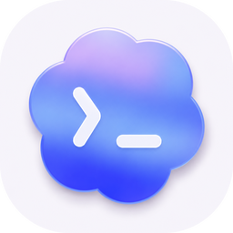

当前项目 fork 自 [BigPizzaV3/CodexPlusPlus](https://github.com/BigPizzaV3/CodexPlusPlus)

# Elves

<p align="center"></p>
<p align="center">中文 | <a href="README_EN.md">English</a></p>
<p align="center">
  
  
  
</p>

Elves 是统一管理 Codex、Claude 会话和本地协议代理的桌面客户端，启动后直接进入本机工作区。独立产品 Harness 提供原生执行、会话和管理服务：Codex 通过独立 app-server 执行，Claude 使用所属实例的原生 CLI。远程会话是 Harness 为网页、PWA 和 Android 提供的一项能力，关闭它不影响 Elves 的启动、使用或本地代理。项目不再提供 Codex App 注入功能。

**[下载安装](https://github.com/junxin367/Elves/releases) · [Windows 客户端](docs/windows-remote-client.md) · [手机连接指南](docs/remote-access-mobile.md)**

## 主导航与功能

左侧主导航宽 52px，按钮为 36px，默认显示图标，悬停显示名称。项目、Codex 和 Claude 图标沿用现有资源。

| 入口 | 功能 |
| --- | --- |
| 会话 | 查看会话列表和项目分组，继续聊天、切换模型及思考深度、处理审批和问答；切换页面后返回同一会话、草稿和阅读位置 |
| 代理设置 | 在同一页管理供应商、模型与协议、本地代理、运行状态、请求日志及请求详情 |
| 会话管理 | 浏览本地会话，按项目和更新时间筛选，单个或批量删除；不提供历史会话修复和上下文压缩配置 |
| 远程会话 | 管理网页服务、zrok/FRP 公网入口、ngrok 第二线路、访问密钥、登录锁定和设备授权 |
| 底部设置 | 管理常规、外观、实例、模型与思考、会话命名、权限、Skills、MCP 和钩子 |

Windows 客户端点击底部设置直接打开设置页。网页、PWA 和 Android 点击后只显示“设置”和“退出”；退出沿用设备授权撤销流程。Windows 的程序退出保留在系统托盘菜单。

外观按客户端独立保存；其他设置由同一 Harness 保存，各客户端共用。配置更新会通知其他端，未保存的输入保留并提示合并，过期版本保存返回冲突。

## 安装与开始使用

Windows x64 安装包为 `Elves-<版本>-windows-x64-setup.exe`，便携客户端为 `Elves-<版本>-windows-x64.exe`。需要 Microsoft Edge WebView2 Runtime，以及服务端已安装并配置的 Codex CLI 或 Claude 实例。

安装程序只部署一个 `elves.exe` 及卸载程序，桌面和开始菜单只保留“Elves”程序入口。Harness 后台由同一程序承载。升级移除旧管理器、launcher、任务看板及其快捷方式，保留设置、密钥、设备授权和登录缓存。

1. 启动 **Elves**，客户端自动准备本机 Harness 并直接打开工作区，无需填写服务地址或访问密钥。
2. 本机管理使用独立授权，不加入远程设备列表。远程会话关闭、只读、换密钥或撤销远程设备均不影响本机客户端。
3. 在“代理设置”配置供应商、Base URL、Key 和模型，逐项核对 Responses API、Chat Completions 或 Anthropic 协议。需要本地代理时在对应供应商打开“启用本地代理”，保存后点击“使用”。
4. 返回“会话”，选择可用实例及项目开始使用。手机访问时，在“远程会话”配置公网入口，按[手机连接指南](docs/remote-access-mobile.md)连接。

关闭 Windows 主窗口会收进托盘并保持本机后台运行。托盘退出时，客户端安全回收自己启动的后台。使用网页或 Android 的远程会话时，运行 Harness 的电脑需要保持开机。

## 代理与会话约束

- 本地代理默认端口为 `45221`，远程网页默认端口为 `45222`，Elves 本机工作区默认端口为 `45223`。已启用供应商打开“启用本地代理”后，代理随 Elves 启动并持续运行，不依赖远程会话开关。
- Responses API 直接调用对应上游；Chat Completions 与 Anthropic 按配置转换。模型列表按协议分别保存，合并展示。
- “发送测试”可临时选择模型；留空使用供应商模型，再缺省才使用全局测试模型。测试请求会调用实际供应商。
- 模型、上下文容量及思考深度取决于所属实例和上游能力。Codex 的 Ultra 默认关闭，只有显式开放且原生支持时可选。
- 供应商切换会更新 Codex 配置及认证文件。官方登录和“官方混入 API”需要有效原生登录状态，API Key 不能代替官方账号权限。
- 删除会话不可恢复，执行中、存在待确认写入或原生引擎占用等情况按既有保护拒绝删除；不通过 Codex App 代执行。
- PC 的文件、变更及子会话在右侧多标签面板打开；手机及 Android 保留整页导航。图片、文件和文件夹可按客户端能力拖动或粘贴进编辑区。

## 数据与升级

| 数据 | 默认位置 |
| --- | --- |
| Codex 配置与认证 | `~/.codex/config.toml`、`~/.codex/auth.json` |
| Codex 会话数据库 | 优先 `~/.codex/sqlite/*.db`，兼容 `~/.codex/state_5.sqlite` |
| 共享设置、日志、密钥和授权 | `~/.codex-session-delete/` |
| Windows 客户端窗口和登录缓存 | `%LOCALAPPDATA%\com.elves.app\`，兼容已有旧目录 |

客户端内置完整网页包，更新按服务 Origin 和 SHA-256 校验；完整资源更新只在下次导航启用，不在使用中自动刷新。安装升级需要短暂关闭客户端和本机后台；旧的管理器热更新流程不适用于统一客户端。卸载保留上述用户数据。

API Key、访问密钥、供应商配置和请求日志可能包含敏感信息，分享前请检查内容。只读远程设备不能通过管理页面读取凭据；本机客户端使用独立的完整管理权限。

## 更多文档

- [产品规范](docs/product-standards.md)：主导航、共享设置和已确认的交互规则。
- [Elves Windows 客户端](docs/windows-remote-client.md)：本机启动、窗口和托盘。
- [手机连接指南](docs/remote-access-mobile.md)、[远程会话技术说明](docs/remote-access.md)。
- [会话工具说明](docs/remote-session-tools.md)：文件、侧边会话、原生引擎与权限边界。
- [网页架构](docs/harness-web-architecture.md)：原生模块、共享管理页面和资源构建。
- [服务更新](docs/remote-service-update.md)、[Android 构建](docs/android.md)、[Android 发布](docs/android-release.md)。

## 开发与构建

需要 Node.js/npm、Rust 工具链，Windows 安装包另需 NSIS。

```powershell
npm --prefix apps/elves-management ci
npm --prefix apps/elves-management run check
npm --prefix apps/elves-management run vite:build
cargo fmt --all -- --check
cargo check --workspace

# Windows 安装包及便携客户端，不附带 Android 构建
.\scripts\build-windows-installer.ps1

# 只构建客户端（修改管理页面时先执行上方 vite:build）
.\scripts\build-windows-client.ps1
```

`apps/elves/` 是唯一桌面程序；`crates/elves-harness/` 是独立 Harness 执行与管理库，`crates/elves-core/` 提供配置和协议代理，`crates/elves-data/` 提供会话数据访问。`apps/elves-management/` 只保留共享管理前端，不再生成管理器应用；构建结果 `assets/harness/management/` 随源码提交。其余工作区网页使用原生 ES module。Android 仅按明确要求单独构建，版本独立维护。
