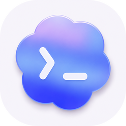

# CodexElves

<p align="center"></p>
<p align="center"><a href="README.md">中文</a> | English</p>

CodexElves brings Codex and Claude conversations, providers, a local protocol proxy, and remote access management into one workspace. The Windows client can start its own local backend or connect to another computer. Browsers, PWAs, and Android use the same interface. Codex runs through an independent app-server, and Claude uses the selected instance's native CLI.

[Downloads](https://github.com/junxin367/Elves/releases) · [Windows client](docs/windows-remote-client.md) · [Mobile guide](docs/remote-access-mobile.md)

## Navigation

The 52px left rail uses 36px icon buttons with 8px on each side. Hover displays each name. Existing project, Codex, and Claude icons remain in use.

| Page | Features |
| --- | --- |
| Conversations | Existing conversation list, projects, and chat workspace; switching pages preserves the current conversation and draft |
| Proxy settings | Provider and model configuration, protocol selection, local proxy status, request logs, and details |
| Conversation management | Browse and filter local sessions; delete individual sessions or a filtered batch; historical repair and compression settings are removed |
| Remote sessions | Web service, public routes, access keys, login lock, and device authorization |
| Bottom settings | General, appearance, instances, models, reasoning depth, session naming, permissions, Skills, MCP, and hooks |

On Windows, the bottom settings button opens settings directly. Other clients show only Settings and Log out. Appearance is stored per client; other preferences are shared through the same service. Stale saves are rejected, preserving unsaved input for review.

## Install and connect

Download `CodexElves-<version>-windows-x64-setup.exe` or the portable `CodexElves-Remote-<version>-windows-x64.exe`. Microsoft Edge WebView2 Runtime is required. The server needs a configured Codex CLI or Claude instance.

The installer installs only the remote client, plus its uninstaller. Upgrades remove the previous manager, launcher, task-board application, and their shortcuts while preserving user data.

1. Open **CodexElves Remote**. Choose **Start local service** to use this computer, or enter an HTTP/HTTPS address to connect elsewhere.
2. The client starts its embedded local backend and pairs using a short-lived, single-use local proof. Other devices pair with an access key.
3. Configure providers and models in **Proxy settings**. Enable the local proxy explicitly when needed; its default port remains `45221`.
4. Return to **Conversations**. Configure public access and device authorization in **Remote sessions** to connect from another device.

Closing the main window minimizes it to the tray and keeps the local backend running. Exiting from the tray safely shuts down the backend owned by this client. Exiting a client connected to another computer does not stop that server.

## Data and updates

Shared settings, credentials, authorization, and logs remain under `~/.codex-session-delete/`. Client connection settings, window state, and WebView2 login data use `%LOCALAPPDATA%\com.codexelves.remote\`. Uninstalling preserves these directories.

The client embeds web resources and verifies updates with SHA-256. Complete updates take effect on the next navigation. Native upgrades use the Windows installer and briefly close the client and its backend; the former manager-only hot-update procedure does not support this installation structure.

Responses API requests use their configured upstream directly. Chat Completions and Anthropic conversions remain available. Model access and reasoning depth depend on the selected instance and provider. Session deletion is permanent and retains native execution and pending-write protections.

## Development

```powershell
npm --prefix apps/codex-elves-manager ci
npm --prefix apps/codex-elves-manager run check
npm --prefix apps/codex-elves-manager run vite:build
cargo fmt --all -- --check
cargo check --workspace
.\scripts\build-windows-installer.ps1
```

The `codex-elves-manager` directory now contains shared web management components and a Rust command library; it no longer builds a desktop manager. Commit generated `assets/remote-access/management/` alongside its source. The Windows build does not build Android. Android versions and signed releases remain independent.

See the [product standards](docs/product-standards.md), [web architecture](docs/remote-access-web-architecture.md), and [release documentation](docs/android-release.md) for the detailed contracts.
